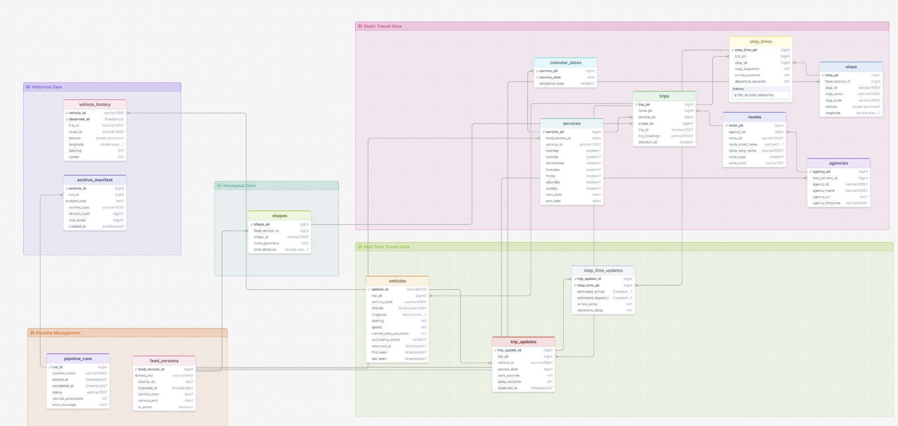
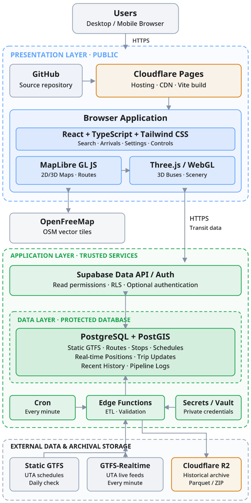
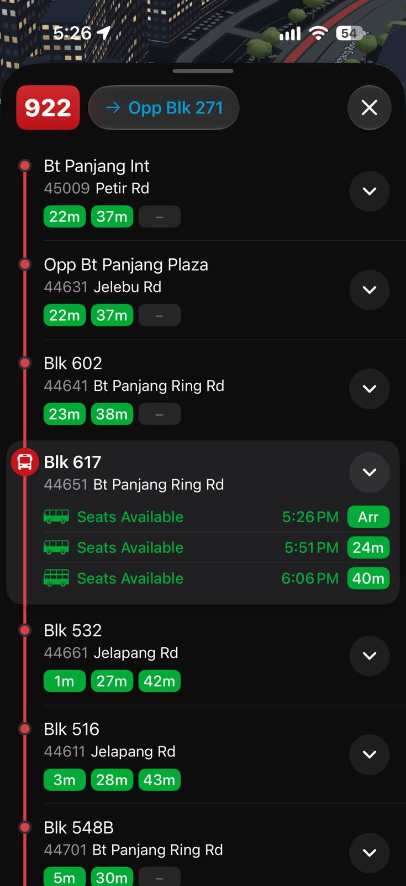
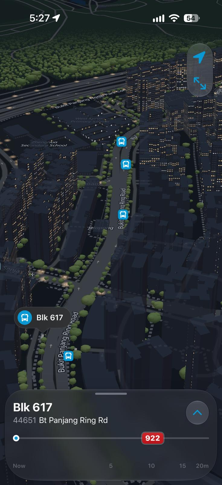
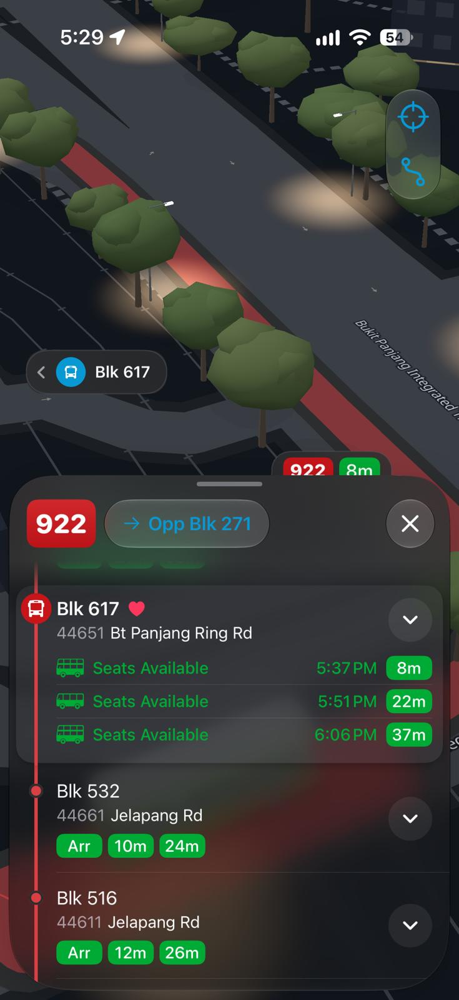
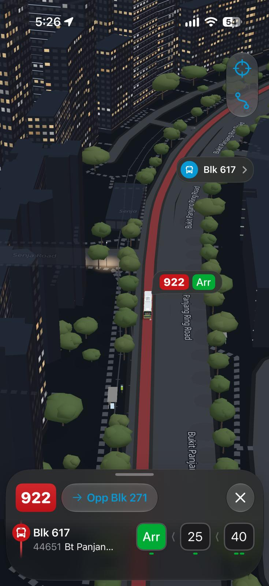

# UTA Real-Time Transit Web App

## Project Purpose and Goals

My goal is to build a web application that helps UTA riders track buses, find nearby stops, and view upcoming arrivals on an interactive 2D and 3D map. Inspired by [NextStop SG](https://nextstopsg.app/), I want to make transit information easier to understand through smooth vehicle animations and a clean interface specially for bus timing. The project will collect UTA transit data every minute, preserve historical observations for future analysis, and aim to operate within free cloud service limits.

## Initial ERD

The proposed PostgreSQL database contains 15 tables grouped by static transit data, geospatial data, real-time transit data, historical data, and pipeline management. PostGIS will support spatial queries and route geometry in the implementation.

## System Design

The frontend will use React, TypeScript, MapLibre GL JS, OpenFreeMap, and Three.js for custom 3D objects. Supabase Cron and Edge Functions will collect and process UTA GTFS-Realtime data every minute, while PostgreSQL and PostGIS store current transit information. Cloudflare R2 will archive historical data, and Cloudflare Pages will host the website. Public access will be read-only for transit data, with ingestion credentials kept on the backend.

## Initial Daily Goals

Schedule starting November 20, 2026.

| Date | Goal |
| --- | --- |
| Nov 20 | Finalize the project scope, ERD, and system design. |
| Nov 21 | Set up the GitHub repository, React frontend, and Supabase project. |
| Nov 22 | Create PostgreSQL tables, enable PostGIS, and configure permissions. |
| Nov 23 | Import static UTA GTFS data and validate relationships. |
| Nov 24 | Implement live vehicle and trip update collection. |
| Nov 25 | Schedule minute-by-minute ingestion and test duplicate prevention. |
| Nov 26 | Implement historical archival to Cloudflare R2. |
| Nov 27 | Integrate MapLibre and OpenFreeMap. |
| Nov 28 | Display live vehicles, stops, and route geometry. |
| Nov 30 | Implement smooth 2D/3D transitions and vehicle interpolation. |
| Dec 1 | Add an initial Three.js bus model.|

## UX Inspiration

The following screenshots are from NextStop SG and illustrate the intended user experience: interactive 3D maps, route information, arrival times, and expandable stop panels. They are references, not screenshots of my completed application.

  
  
  
  

Source: [NextStop SG](https://nextstopsg.app/).
